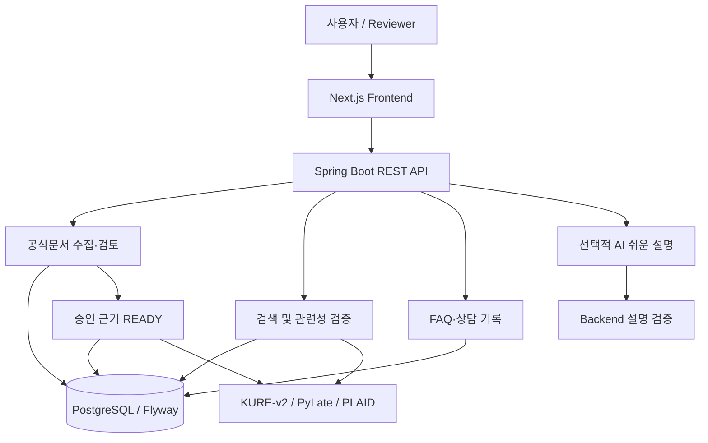
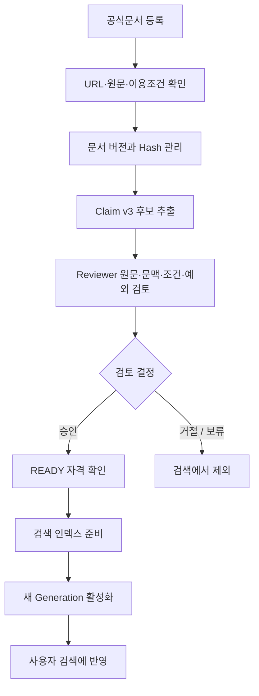
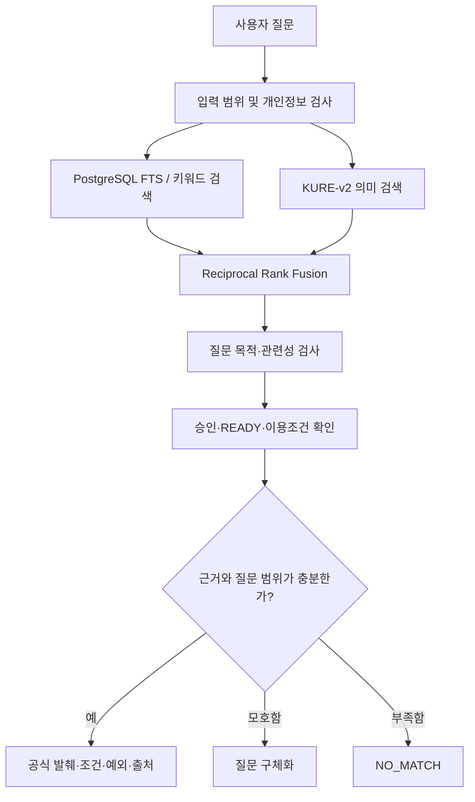
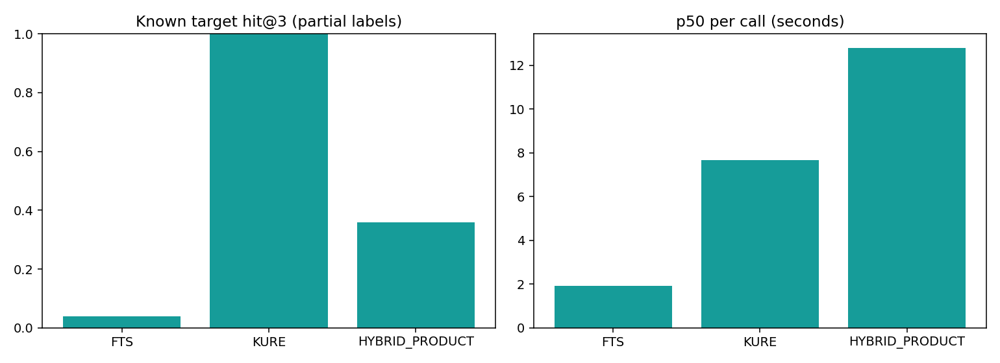
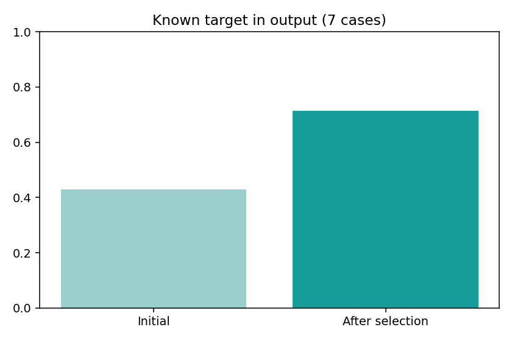

# 금융도우미 Backend

공식 금융문서를 수집·검토하고, 사람이 승인한 근거(Claim)를 대상으로 검색을 수행해 사용자의 질문에 맞는 금융정보와 출처를 제공하는 Spring Boot Backend입니다.

금융정보의 정확성과 검증 가능성을 위해 다음 과정을 분리했습니다.

**공식문서 등록 → Claim 후보 추출 → Reviewer 승인 → READY 활성화 → Hybrid 검색 → 관련성·자격 검증 → 공식 근거 제공**

AI는 승인된 근거를 쉽게 설명하는 선택적 보조 기능이며, 검증되지 않은 금융 사실이나 개인별 적용 결과를 확정하지 않도록 설계했습니다.

## 1. 핵심 기능

| 영역 | 구현 내용 |
| --- | --- |
| 공식문서 관리 | 공식 URL 수집, 원문 정규화, 문서 버전·Hash 관리 |
| Claim v3 | 원문 발췌와 조건·예외를 포함한 후보 추출 |
| Reviewer | 사람의 Claim 검토·승인·거절 및 감사 이력 |
| READY | 승인된 근거의 검색 자격 검증과 활성 Generation 관리 |
| 검색 | PostgreSQL FTS/키워드, KURE-v2, RRF |
| 질문 구체화 | 대상·목적이 모호한 질문에 대한 추가 선택지 |
| FAQ | 승인된 공식 근거와 연결된 공개 질문 관리 |
| 상담 기록 | 저장·조회·삭제 및 근거 변경에 따른 유효성 확인 |
| AI 설명 | 이용조건 검사, 생성 결과 검증 및 실패 시 fallback |
| 보안 | 인증, Reviewer 권한, CSRF·CORS, 소유권, 개인정보 처리 제한 |

## 2. 시스템 아키텍처



### 구성 요소

- **Spring Boot:** API, 도메인 검증, 권한 및 검색 결과 제어
- **PostgreSQL:** 공식문서, Claim, 승인·감사 이력, FAQ, 상담 기록의 기준 저장소
- **Flyway:** 데이터베이스 스키마 변경 이력 관리
- **KURE-v2:** 한국어 금융 질문의 의미적 유사성 검색
- **PyLate / PLAID:** KURE-v2의 late-interaction 검색 인덱스
- **OpenAI SDK:** 선택적 생성형 AI 설명 기능

## 3. 공식문서와 Claim 처리



### Claim v3

공식문서에서 추출한 문장과 적용 조건·예외를 검토 가능한 후보로 관리합니다.

추출된 문장이 원문과 일치한다는 사실만으로 해당 내용의 의미적 정확성이나 현재 적용 가능성이 검증되는 것은 아닙니다.

Reviewer가 문서 원문과 전후 문맥을 확인하고 승인 여부를 결정합니다.

### READY 및 Generation

- 승인된 Claim 중 현재 검색에 사용할 자격이 있는 항목을 선정합니다.
- 문서 이용조건과 활성 후보 버전을 확인합니다.
- 인덱스 준비 및 활성 세대 전환을 구분합니다.
- 기존 승인·거절·감사 이력은 보존합니다.
- 근거 변경 시 저장된 결과가 이전 내용을 그대로 노출하지 않도록 유효성을 재검사합니다.

이 구조는 문서 수집 성공과 실제 검색 가능 상태를 분리하기 위한 설계입니다.

## 4. Hybrid 검색



### 검색 구성

**PostgreSQL FTS / 키워드 검색**

공식문서에 포함된 표현과 질문의 단어·접두어·문맥을 기반으로 후보를 조회합니다.

**KURE-v2 의미 검색**

KURE-v2의 token-level multi-vector 표현과 MaxSim late interaction을 활용합니다. 단일 벡터 cosine 유사도로 임의 대체하지 않고 Python 검색 런타임을 분리했습니다.

**RRF**

서로 다른 검색 결과의 순위를 결합해 후보를 구성합니다. RRF 점수를 금융정보의 사실 확률이나 신뢰도로 해석하지 않습니다.

**관련성 및 근거 자격 검사**

검색 후보가 있더라도 질문 목적, 대상, 조건과 공개 자격이 맞지 않으면 확정 근거로 채택하지 않습니다.

## 5. 질문 구체화

사용자의 질문에 여러 대상이나 목적이 포함될 수 있으므로, 필요한 경우 선택형 추가 질문을 제공합니다.

- 질문 범위가 명확하면 곧바로 근거를 확인합니다.
- 의미 있는 구분이 필요한 경우 문서·목적 선택지를 제공합니다.
- 선택 결과를 반영해 다시 검색합니다.
- 적절한 근거가 없으면 다른 금융상품의 결과를 임의로 확정하지 않습니다.

질문 구체화는 검색 결과를 무조건 늘리는 기능이 아니라, 사용자 의도를 명확히 하기 위한 단계입니다.

## 6. 안전성 및 개인정보

### 공식 근거 자격

문서 등록과 검색 허용 여부를 분리하고, 다음 범위를 개별적으로 검토합니다.

- 원문 수집 및 저장
- Claim 추출
- 검색 인덱스 반영
- 사용자에게 원문 발췌 표시
- FAQ 이용
- 외부 AI 제공자에게 근거 전달

승인되지 않았거나 이용조건을 충족하지 못한 근거는 공개 검색 결과에서 제외합니다.

### 인증 및 권한

- 일반 사용자와 Reviewer의 역할 구분
- 로그인 세션 및 리소스 소유권 검사
- CSRF 및 CORS 처리
- 상담 기록 조회·삭제 권한 확인
- 저장된 근거의 변경 상태 검사

### AI 설명

AI 설명은 공식 근거를 대체하지 않습니다.

- 외부 AI 전달이 허용된 근거만 사용
- 사용자 질문 원문을 외부 Provider에 전달하지 않도록 제한
- 생성문에 대한 객관적 검사와 의미 검증
- 검증 실패 시 공식 근거 기반 fallback
- AI 기능 기본 비활성화

실제 AI 의미 검증의 정상 성공률과 오탐·미탐 수준은 충분히 검증되지 않았으며 후속 평가 대상입니다.

## 7. 기술 스택

| 영역 | 기술 |
| --- | --- |
| 언어 | Java 21 |
| 프레임워크 | Spring Boot 4.1.0 |
| 보안 | Spring Security |
| 데이터베이스 | PostgreSQL |
| 데이터 접근 | Spring Data JPA |
| 스키마 관리 | Flyway |
| 공식 HTML 처리 | jsoup |
| PDF 처리 | Apache PDFBox |
| HWP 처리 기반 | Apache POI |
| AI SDK | OpenAI Java SDK |
| 의미 검색 | KURE-v2, PyLate 1.6.0, PLAID |
| 테스트 | JUnit, 격리 PostgreSQL 통합 테스트 |

## 8. 정량 평가

2026년 11월 20일에 실제 PostgreSQL과 KURE-v2 런타임을 이용해 평가했습니다.

### 평가 데이터

| 항목 | 규모 |
| --- | ---: |
| 활성 공식문서 | 5건 |
| 활성 Claim v3 | 41건 |
| 검색 평가 질문 | 30개 |
| 답변 가능 질문 | 25개 |
| 미지원 질문 | 5개 |
| 질문 구체화 시나리오 | 10개 |

### 검색 평가 결과

| 평가 경로 | 대표 정답 Hit@3 |
| --- | ---: |
| PostgreSQL FTS 재현 (원시 후보) | 1/25 (4%) |
| KURE-v2 (원시 후보) | 25/25 (100%) |
| Hybrid 제품 최종 확정 근거 | 9/25 (36%) |



**평가 해석에 유의해야 합니다.**

FTS와 KURE는 원시 검색 후보, Hybrid는 관련성·자격 검사 이후의 최종 근거를 평가했습니다. 동일 단계에서 측정한 값이 아니므로 Hybrid 검색이 다른 방법보다 우수하거나 열등하다고 단순 결론 내릴 수 없습니다.

또한 문항별 대표 정답 Claim 하나를 고정한 대리지표이며, 질문은 활성 근거를 참고해 작성했습니다. 실제 사용자 질문 전체에 대한 일반적인 정확도로 해석할 수 없습니다.

### 미지원 질문

미지원 질문 5건은 모두 최종 제품 응답에서 확정 근거 없이 `NO_MATCH`로 처리됐습니다.

KURE 원시 검색이 미지원 질문에 의미적으로 가까운 후보를 반환하더라도, 이는 최종 채택 근거와 구분됩니다.

### 질문 구체화 평가

답변 가능한 7개 시나리오에서 대표 정답 포함 사례가 다음과 같이 관측됐습니다.

- 구체화 이전: 3/7
- 선택 경로 이후: 5/7



구체화가 일부 질문의 근거 탐색에 도움을 줄 가능성을 확인했지만, 시나리오 수가 작고 부분 정답셋을 사용했으므로 성능 향상을 일반화할 수 없습니다.

### AI 안전성 평가

- 기존 검증기와 Mock 기반 단위 테스트 21건 통과
- 정량평가 실행 중 실제 외부 Provider 호출 0회
- 실제 생성 품질·의미 검증의 오탐·미탐은 별도 실측 필요

## 9. 평가를 통해 발견한 문제

Q03, Q16, Q25에서는 독립 KURE 원시 검색에서 대표 정답 근거가 1위였지만, 제품 최종 응답은 `NO_MATCH`였습니다.

사후 코드 재현에서는 금액·한도, 방법, 숫자 요구 등의 관련성 규칙이 근거를 과도하게 제외할 수 있음을 확인했습니다.

다만 평가 당시 제품 내부의 모든 RRF 후보와 처리 단계가 기록된 것은 아니므로, 당시 요청의 정확한 내부 분기를 완전히 입증한 결과는 아닙니다.

후속 개선에서는 같은 검색 단계의 후보를 비교하고, 관련성 필터의 과잉 차단을 줄이는 방향으로 검증할 계획입니다.

자세한 실험 조건, 질문, 원시 결과 및 그래프는 다음 문서에 있습니다.

[정량평가 상세 결과](docs/evaluation-v3-20261120/summary.md)

## 10. 프로젝트 구조

```text
financial-helper-backend/
├── src/
│   ├── main/
│   │   ├── java/com/financialhelper/
│   │   │   ├── account/
│   │   │   ├── ai/
│   │   │   ├── consultation/
│   │   │   ├── retrieval/
│   │   │   ├── source/
│   │   │   └── ...
│   │   └── resources/
│   │       ├── application.yml
│   │       ├── application-local.yml
│   │       └── db/
│   └── test/
├── retrieval_runtime/
│   ├── runtime.py
│   ├── requirements.txt
│   └── tests/
├── scripts/local/
├── docs/
│   └── evaluation-v3-20261120/
├── build.gradle
├── gradlew.bat
└── README.md
```

## 11. 로컬 실행

### 요구 환경

- Java 21
- Python 및 KURE-v2 실행에 필요한 의존성
- PostgreSQL
- Gradle Wrapper
- 필요시 Docker 및 Docker Desktop

### Backend 기본 실행

`application-local.yml`에서는 데이터베이스 연결정보를 환경변수로 읽습니다.

```text
DB_URL
DB_USERNAME
DB_PASSWORD
```

실행 전 실제 로컬 PostgreSQL 연결정보를 환경변수로 설정합니다.

```powershell
.\gradlew.bat bootRun
```

기본 Backend 포트는 `8080`이며, 환경변수 `PORT`로 변경할 수 있습니다.

로컬 설정에서는 법령 API 기능이 활성화될 수 있으므로, 외부 API를 사용하지 않는 격리 테스트에서는 해당 설정과 필요 권한을 별도로 확인해야 합니다.

### KURE-v2 검색 런타임

```powershell
py -m pip install -r retrieval_runtime/requirements.txt
py -m retrieval_runtime.runtime --host 127.0.0.1 --port 8091
```

`bootRun`은 KURE 런타임을 자동으로 시작하지 않습니다.

실제 의미 검색에는 모델 파일, 의존성, 활성 Generation에 맞는 인덱스와 Backend 설정이 필요합니다.

### 분리된 로컬 시연 환경

저장소에 포함된 `scripts/local/separate-review-demo.ps1`은 별도 PostgreSQL 컨테이너와 Frontend·Backend·KURE 런타임을 구성하는 시연 스크립트입니다.

기본 포트 구성은 다음과 같습니다.

| 서비스 | 포트 |
| --- | ---: |
| Frontend | 13000 |
| Backend | 18080 |
| PostgreSQL | 15439 |
| KURE | 18092 |

실행 전 스크립트의 사전 조건과 기존 리소스 보존 정책을 확인해야 합니다. OAuth 제공자 설정이 필요하며 AI는 기본적으로 활성화하지 않습니다.

시연 DB와 활성 인덱스를 불필요하게 초기화하거나 재생성하지 않습니다.

## 12. 테스트 및 검증

Windows PowerShell 기준:

```powershell
.\gradlew.bat test
.\gradlew.bat build
.\gradlew.bat bootJar
```

KURE 런타임 관련 Python 테스트는 별도로 관리합니다.

### 2026년 11월 22일 Backend PR #23 검증

| 검증 항목 | 실제 결과 |
| --- | --- |
| 전체 기본 테스트 | 총 536건, 통과 527건, 실패 0건, 조건부 건너뜀 9건 |
| 격리 PostgreSQL | 상담 기록 및 READY 통합 테스트 포함 |
| KURE 런타임 계약 테스트 | 4건 통과 |
| Gradle build | 성공 |
| bootJar | 성공 |
| Merge 이후 Smoke Test | 통과 26건, 조건부 건너뜀 1건, 실패 0건 |

GitHub Actions 자동 검사가 아닌 로컬 실행 결과입니다.

### 공개 저장소 관리

국가법령정보센터의 원본 HTML 전체를 공개할 재배포 권한을 확인하지 못해, 관련 단위 테스트에는 직접 작성한 합성 HTML Fixture를 사용했습니다.

기존 원본은 비공개 로컬 위치에 보존하고, 새 공개 Git 이력에는 원본 HTML이 포함되지 않도록 검사했습니다.

합성 Fixture의 무결성 테스트와 비공개 실제 원본의 동일성 검증은 구분합니다.

## 13. 한계 및 개선 방향

- 공식문서 5건만으로 전체 금융 주제를 지원할 수 없습니다.
- 검색 후처리 관련성 규칙이 올바른 근거를 과도하게 제외할 수 있습니다.
- 검색 평가에 사용된 질문과 단일 대표 정답 기준은 실제 사용자 질문을 충분히 대표하지 않습니다.
- 실제 AI 설명의 정상 생성 품질과 의미 검증 정확도는 추가 평가가 필요합니다.
- 일부 실제 브라우저 통합 테스트와 반응형 화면 검증이 남아 있습니다.
- 공식 원문의 변경 여부 확인과 현재 법령·정책의 적용 가능성 판단은 서로 다른 문제입니다.

이후 작업은 안정된 `main`을 기준으로 새 개발 브랜치에서 검색 평가 확대, AI 의미 검증 분석, 관련성 규칙 개선 및 선택적 리팩토링을 수행할 예정입니다.

## 14. 관련 링크

- [Frontend Repository](https://github.com/Economy0326/financial-helper-frontend)
- [프로젝트 기술 문서](https://app.notion.com/p/3bd25931ce3580ae8ad8f0fa3acdf41a)