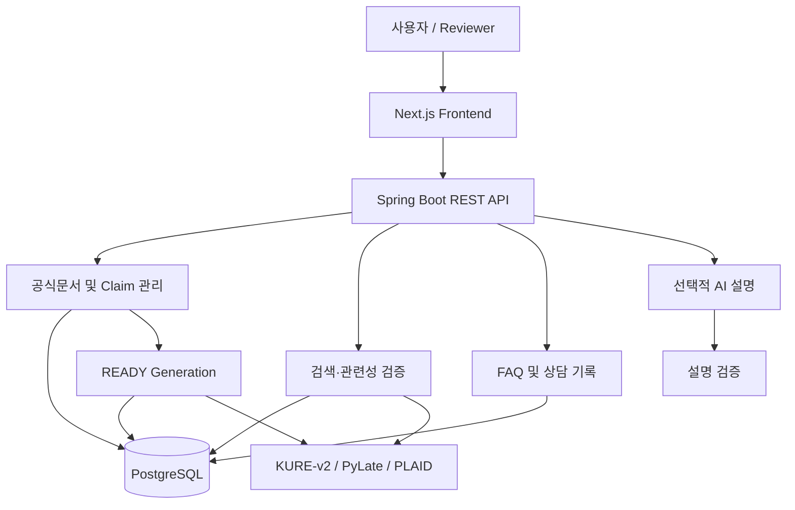
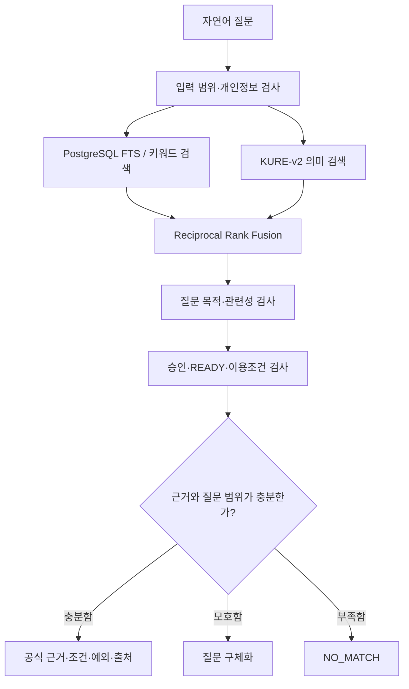

# 금융도우미 Backend

금융도우미 Backend는 공식 금융문서에서 추출한 근거를 사람이 검토·승인하고, 사용자의 자연어 질문에 관련된 금융정보와 출처를 제공하는 Spring Boot 서비스입니다.

금융정보를 AI가 임의로 생성하는 대신, 공식 근거의 적용 조건과 예외를 확인할 수 있도록 설계했습니다.

## 1. 핵심 설계

금융정보 서비스에서 중요한 것은 단순히 관련 문장을 검색하는 것뿐 아니라, 해당 문장이 어떤 상품과 조건에 적용되는지 확인하는 것입니다.

이를 위해 문서 등록과 검색 가능 상태를 분리했습니다.

```text
공식문서 등록
    ↓
원문·출처·이용조건 확인
    ↓
Claim 후보 추출
    ↓
Reviewer 원문·조건·예외 검토
    ↓
Claim 승인 및 READY 자격 확인
    ↓
검색 인덱스·Generation 활성화
    ↓
Hybrid 검색
    ↓
관련성 및 공개 자격 검증
    ↓
공식 근거·출처 제공
```

### Claim과 Reviewer

Claim은 공식문서에서 추출한 개별 근거 후보입니다.

추출된 문장의 위치와 원문 Hash가 일치하더라도 금융정보의 조건·예외가 정확하게 연결됐다는 의미는 아닙니다.

Reviewer는 원문 발췌, 앞뒤 문맥, 적용 조건과 제외사항을 확인한 뒤 승인 여부를 결정합니다.

### READY와 Generation

Claim 승인과 실제 검색 활성화는 별개의 과정입니다.

READY는 승인 상태, 문서 이용조건, 선택된 후보 버전 등을 확인하고 검색에 반영할 적격 근거를 선정합니다.

Generation은 현재 검색에 사용되는 Claim 집합과 인덱스의 버전을 관리합니다.

## 2. 시스템 아키텍처



### 주요 기술

| 영역 | 기술 |
| --- | --- |
| Language | Java 21 |
| Framework | Spring Boot 4.1.0 |
| Security | Spring Security |
| Database | PostgreSQL |
| Data Access | Spring Data JPA |
| Migration | Flyway |
| HTML 처리 | jsoup |
| PDF 처리 | Apache PDFBox |
| HWP 처리 기반 | Apache POI |
| 의미 검색 | KURE-v2, PyLate, PLAID |
| AI SDK | OpenAI Java SDK |

## 3. Hybrid 검색

사용자 질문의 단어 표현과 의미적 유사성을 함께 활용하기 위해 두 검색 경로를 결합했습니다.



### PostgreSQL FTS

공식문서와 질문에 등장하는 단어·표현을 기반으로 검색 후보를 찾습니다.

### KURE-v2

한국어 질문의 의미적 유사성을 탐색합니다.

KURE-v2의 token-level multi-vector 표현과 MaxSim late interaction 방식을 유지하기 위해 별도의 Python 검색 런타임을 사용합니다.

### RRF

FTS와 KURE 검색 결과의 순위를 결합하여 후보 목록을 구성합니다.

RRF는 순위 결합 방식이며, 결합 점수를 금융정보의 사실 확률로 해석하지 않습니다.

### 관련성 및 자격 검증

검색 상위에 나온 Claim이라도 질문한 상품, 신청 목적, 금액 조건이나 공개 자격이 일치하지 않으면 최종 근거로 확정하지 않습니다.

질문 자체가 모호하면 필요한 범위를 추가로 확인합니다.

## 4. 공식 근거와 AI 설명의 분리

공식문서에 기반한 검색 결과와 생성형 AI 설명은 서로 다른 역할을 담당합니다.

- **공식 근거:** 승인된 원문 발췌, 출처, 적용 조건과 예외
- **선택적 AI 설명:** 확인된 공식 근거를 이해하기 쉬운 표현으로 설명

AI 설명 기능에는 이용조건과 개인정보 검사, 객관적 사실 검사, 별도 의미 검증 및 실패 시 fallback 처리를 적용했습니다.

생성된 설명을 공식 근거보다 우선하지 않으며, 검증되지 않은 설명을 확정적 금융정보로 사용하지 않습니다.

## 5. 보안 및 데이터 정합성

- 일반 사용자와 Reviewer 권한 분리
- 로그인 세션과 리소스 소유권 검사
- CSRF 및 CORS 처리
- 상담 기록 저장·조회·삭제 권한 확인
- 승인되지 않은 Claim의 검색 제외
- 원문 변경 및 검색 자격 변화에 따른 저장 결과 유효성 검사
- 문서 저장·검색·발췌·외부 AI 전달 이용조건의 개별 확인
- 개인정보 포함 가능성이 있는 요청에 대한 외부 전송 제한

공식문서를 등록했다는 사실만으로 검색 또는 외부 AI 전달이 허용되는 것은 아닙니다.

## 6. 검색 정량평가

2026년 11월 20일, 실제 PostgreSQL과 KURE-v2 검색 런타임으로 공식문서 기반 검색을 평가했습니다.

### 평가 데이터

| 항목 | 수량 |
| --- | ---: |
| 공식문서 | 5건 |
| 활성 Claim v3 | 41건 |
| 검색 질문 | 30건 |
| 답변 가능 질문 | 25건 |
| 미지원 질문 | 5건 |

### 검색 평가 결과

| 측정 경로 | 대표 정답 Hit@3 |
| --- | ---: |
| PostgreSQL FTS 원시 후보 재현 | 1/25 (4%) |
| KURE-v2 원시 후보 | 25/25 (100%) |
| 제품 최종 Hybrid 확정 근거 | 9/25 (36%) |

**평가 해석**

FTS와 KURE는 원시 검색 후보를, Hybrid는 관련성·자격 검사를 거친 최종 확정 근거를 측정했습니다.

따라서 세 수치는 동일한 처리 단계의 모델 성능 비교가 아닙니다.

또한 질문당 대표 정답 Claim 하나를 기준으로 측정했고, 평가 질문은 승인된 문서를 참고해 작성했습니다. 전체 사용자 질문에 대한 일반적인 정확도로 해석하지 않습니다.

### 평가에서 확인한 문제

Q03·Q16·Q25는 KURE 원시 검색에서 대표 정답이 1위였으나, 제품 최종 결과는 `NO_MATCH`였습니다.

이후 코드 재현을 통해 금액 표현, 질문 목적, 숫자 요구 등의 관련성 규칙이 올바른 근거까지 제외할 수 있음을 확인했습니다.

이 사례는 검색 후보의 순위뿐 아니라 **최종 후처리 이후에도 정답이 유지되는지** 검증해야 하는 이유가 됐습니다.

### 질문 구체화 평가

답변 가능한 7개 시나리오에서 대표 정답 포함 결과는 다음과 같았습니다.

- 구체화 전: 3/7
- 선택 경로 이후: 5/7

질문 구체화가 일부 질문에서 근거 탐색에 도움이 될 가능성을 확인했습니다.

### 평가 자료

- [검색 평가 요약 및 원시 자료](docs/evaluation-v3-20261120/summary.md)
- [평가 데이터 디렉터리](docs/evaluation-v3-20261120)

## 7. 테스트

Backend 단위·통합 테스트, 격리 PostgreSQL 검증, READY 및 검색 경로 테스트, KURE 런타임 계약 테스트를 수행했습니다.

Windows PowerShell 기준:

```powershell
.\gradlew.bat test
.\gradlew.bat build
.\gradlew.bat bootJar
```

Python 검색 런타임은 별도 테스트를 사용합니다.

공개 저장소에는 이용권이 불명확한 공식 원문을 그대로 포함하지 않고, 검증 목적의 합성 HTML Fixture를 사용했습니다.

## 8. 로컬 실행

### 요구 환경

- Java 21
- PostgreSQL
- Python 및 KURE-v2 의존성
- Gradle Wrapper
- 필요시 Docker Desktop

### Backend 실행

로컬 데이터베이스 연결정보를 환경변수로 설정합니다.

```text
DB_URL
DB_USERNAME
DB_PASSWORD
```

실행 명령:

```powershell
.\gradlew.bat bootRun
```

기본 Backend 포트는 `8080`입니다.

### KURE-v2 검색 런타임

```powershell
py -m pip install -r retrieval_runtime/requirements.txt
py -m retrieval_runtime.runtime --host 127.0.0.1 --port 8091
```

실제 의미 검색에는 로컬 모델 파일과 활성 Generation에 맞는 인덱스가 필요합니다.

Backend 실행만으로 KURE 런타임이 자동 실행되지는 않습니다.

### 분리된 로컬 시연

`scripts/local/separate-review-demo.ps1`은 분리된 PostgreSQL, Backend, Frontend 및 KURE 실행 환경을 구성하는 시연 스크립트입니다.

기존 시연 데이터와 인덱스를 보존하도록 실행 전 환경 설정을 확인해야 합니다.

## 관련 링크

- [Frontend Repository](https://github.com/Economy0326/financial-helper-frontend)
- [금융도우미 프로젝트 문서 (Notion)](https://app.notion.com/p/3bd25931ce3580ae8ad8f0fa3acdf41a)